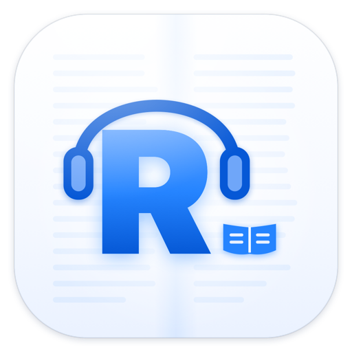

<p align="center">
  
</p>

<h1 align="center">Ronic Reader</h1>

<p align="center">
  <b>PDF and EPUB books read aloud with a natural Brazilian Portuguese voice, as an open book you can follow on screen.</b><br>
  Free to use forever · no paid APIs · offline voices on the device · macOS, iPad and iPhone
</p>

<p align="center">
  <a href="https://github.com/jhowmael/Ronic-Reader/releases/latest/download/RonicReader.dmg">
    
  </a>
  &nbsp;
  <a href="https://jhowmael.github.io/Ronic-Reader/">
    
  </a>
</p>

<p align="center">
  <a href="https://github.com/jhowmael/Ronic-Reader/releases">All releases</a> ·
  <a href="#installation">Installation</a> ·
  <a href="#features">Features</a> ·
  <a href="#build-and-test-locally">Build locally</a>
</p>

---

## Downloads

| System | File | Requirements |
|---|---|---|
| **macOS** (Apple Silicon) | [`RonicReader.dmg`](https://github.com/jhowmael/Ronic-Reader/releases/latest/download/RonicReader.dmg) (installer) · [`.zip`](https://github.com/jhowmael/Ronic-Reader/releases/latest/download/RonicReader-macOS.zip) | macOS 13 Ventura or later |
| **iPad / iPhone** | [jhowmael.github.io/Ronic-Reader](https://jhowmael.github.io/Ronic-Reader/) | Safari on iPadOS / iOS 17+ |

## Installation

**macOS.** Open the `.dmg` and drag **Ronic Reader** to Applications. The app is not notarized by Apple, so the first time right-click it › **Open** (or run `xattr -dr com.apple.quarantine "/Applications/Ronic Reader.app"`).

**iPad and iPhone.** Open the link in Safari › **Share** › **Add to Home Screen**. It runs like an app, works offline after the first use and keeps your library on the device. The voice model (about 90 MB) is downloaded the first time you press play.

## Features

* **An open book.** Each sheet is a page of the PDF (EPUB books are split into book-sized pages), with a 3D page turn. **Click or tap any paragraph** and reading starts there; the current paragraph is highlighted and pages turn on their own.
* **Natural voices, Brazilian accent.** Online neural voices (Francisca, Thalita, Antônio and multilingual voices) and 11 **offline** Kokoro voices that run on your device. The offline voices were tuned and chosen by measuring their Brazilian accent with a phoneme recognizer (`voice-lab/sotaque.py`). Each voice shows its region in the list.
* **Narration by context.** One switch: the app finds how many narrators the book has (point-of-view chapters such as "3 — Briana", or a first-person narrator by gender) and reads each chapter with that narrator's voice. Pick a voice per narrator.
* **Instant controls.** Speech speed from 0.5× to 2.5× without regenerating audio, voice switching that starts in about a second, focus mode that enlarges the book when the side panels are closed.
* **Library.** Covers, search, reading position per book, rename, change the cover (an image or a page of the PDF).
* **Clean text.** Removes repeated headers and footers, page numbers ("Página 4 de 15"), hyphenation and line breaks; finds chapters from the PDF outline, "Capítulo" headings or numbered sections, and a title from the cover when the file name says nothing.
* **macOS extras.** Save the book as MP3 (one file per chapter), Liquid Glass look with a white or macOS accent color, light/dark theme, and a command line (`ronic book.pdf`).

## Build and test locally

```bash
python3.13 -m venv .venv && .venv/bin/pip install -e ".[offline,app,dev]"
make dev        # run the macOS app from source
make test       # tests
make app        # dist/Ronic Reader.app + RonicReader-macOS.zip + RonicReader.dmg
make ios-dev    # iPad/iPhone web app at http://localhost:8080
make icons      # regenerate the logo (branding/make-logo.swift) and icons
```

Releases are published by `.github/workflows/release.yml` when a `v*` tag is pushed, and the iPad/iPhone app by `.github/workflows/pages.yml` on every push to `main` (enable it once in **Settings › Pages › Source: GitHub Actions**).

## How it works

| Part | macOS app | iPad / iPhone (web app) |
|---|---|---|
| Interface | `ronic_reader/web/index.html` in a native window (pywebview) | the same file, served by GitHub Pages |
| Text | `ronic_reader/` (pypdf, EPUB reader) | `ios-web/engine/` (PDF.js, JSZip), same rules ported to JavaScript |
| Voice | edge-tts (online) and Kokoro (onnxruntime) | Kokoro in a Web Worker (onnxruntime-web, WebGPU when available) |
| Library | `~/Library/Application Support/Ronic Reader` | IndexedDB on the device |
